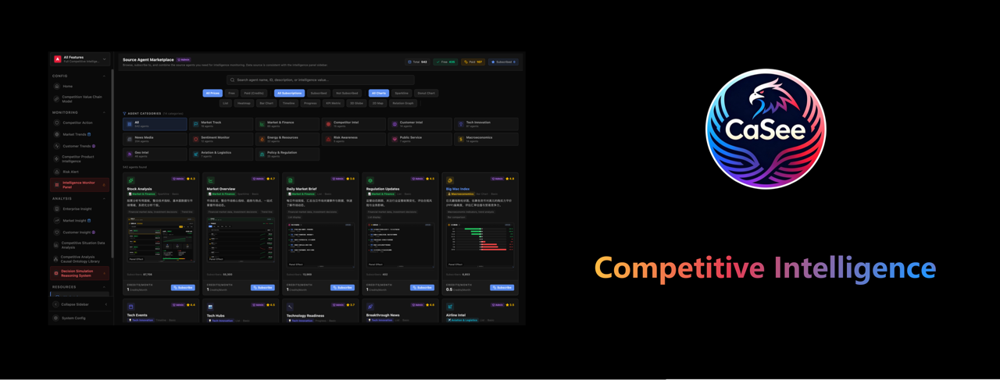

# CaSee Market Intelligence Expert · DSH Plugin
*Powered by the CaSee intelligence platform — turn 500+ trusted sources into a traceable market analyst*

<p align="center">
  
</p>
<p align="center">
  <a href="https://www.npmjs.com/package/dsh-plugin-market-intelligence"></a>
  <a href="https://nodejs.org/"></a>
  <a href="LICENSE"></a>
  <a href="https://casee.me"></a>
</p>

[简体中文](README.md) | **English**

***
## About CaSee — AI-Driven Competitive Intelligence Platform

**CaSee** is an **AI-driven competitive intelligence & market insight platform** — "Win by strategy, sense opportunities first, decide a thousand miles ahead".

CaSee delivers **trusted-source competitive intelligence** that helps startups find market opportunities and established enterprises expand their competitive advantages. It solves the core pain points of enterprise competitive intelligence:

- Fragmented intelligence collection
- Inefficient manual analysis
- Outdated market insights
- Intelligence that never reaches business decisions

Built for market, sales, product, and strategy teams of mid-to-large enterprises, CaSee connects market data with business decision-making — upgrading from **passive competitive monitoring** to **proactive market trend prediction**.

### Platform Capabilities

| Capability | Description |
| --- | --- |
| **Real-time Competitive Sensing** | Monitor competitors, markets and customers per business line; panoramic external-environment scanning; tiered real-time threat alerts |
| **Quantified Threat Analysis** | SWOT, PESTEL, BCG Matrix, VRIO Framework and more — evaluate industry profitability, competitive landscape and policy risk |
| **Proactive Strategy Evaluation** | A proprietary neural-causal long-chain reasoning engine predicts strategy effects — open-world reasoning for long chains, closed-world reasoning for quantified outcomes |
| **Trusted Intelligence Collection** | Real-time competitor tracking, market trend prediction, fusion of fragmented intelligence, goal-directed sensing |
| **Expert Competitive Analysis** | Custom CI capability building, self-service professional reports, industry expert knowledge base |

> **Trusted Intelligence Assurance**: quantified T-Score credibility scoring, multi-source cross-validation, causal-reasoning bias detection and compliance guardrails prevent AI hallucination, stale data and false citations.
> **Try CaSee**: <https://casee.me> — register and claim your API key.

***
## 🎯 What is this

`dsh-plugin-market-intelligence` is a market-intelligence expert plugin for **DeepSeek Harness (DSH)** (a `dsh.bundle` package). Once installed it contributes three things to the active profile, turning CaSee intelligence into native, model-callable capability:

| Contribution | Detail |
| --- | --- |
| **6 model-facing tools** | `find_trusted_sources`, `search_intelligence`, `analyze_trend`, `aggregate_by_source`, `search_with_cvc`, `semantic_search` |
| **Expert persona section** | Registered as the `market-intelligence:expert` system-prompt section (order 5): analyst role, three iron rules, T-Score/ABCD grading, retrieval method, dual-format output contract |
| **Bundled skill** | The `market-intelligence` runtime skill (`ctx.skills`): core workflow, search strategy, market workflow, report templates and the **HTML report style spec** |

> **Retrieval channel**: the plugin calls the CaSee **REST** API (`/v1/sources/search`, `/v1/searchx`, `/v1/semantic-search`). It is independent of the MCP endpoint at `causalai.me:8100` — two separate channels.

***
## 🤖 Why use it

Wiring competitive intelligence into an agent usually means hand-rolling HTTP handling, field mapping, dedupe, statistics, caching, scheduling, security review and a report style — for every source, in every product.

`dsh-plugin-market-intelligence` turns that into **one install plus one contract**:

| Dimension | Hand-rolled integration | With this plugin |
| --- | --- | --- |
| **Time to first analysis** | Days (backend + frontend + glue) | One `dsh plugin add` |
| **Data credibility** | Judge source trustworthiness yourself | Every item carries T-Score + ABCD grading, fully traceable |
| **Retrieval** | Build search and filters yourself | Google-style query syntax + two-stage trusted retrieval + CVC semantic search |
| **Report delivery** | Write templates and charts yourself | Built-in CaSee dark-dashboard spec (appbar / cover / TOC / numbered sections / ECharts / sources) |
| **Hallucination risk** | Prompt discipline only | No-fabrication enforced at both the tool and persona layers |

> **Core value**: market intelligence becomes an **installable, configurable, reproducible** Harness capability, with reports matching CaSee's official report style.

***
## 🚀 Quick Start

### Prerequisites

- **Node.js ≥ 22.19** (DSH runtime requirement)
- **DeepSeek Harness `dsh` ≥ 0.1.0-rc.6** (check with `dsh --version`)
- A **CaSee API key** — register free at <https://casee.me>

### Step 1 — Install

```bash
# A. npm (recommended; the package name is the identity)
dsh plugin --profile web add dsh-plugin-market-intelligence

# B. GitHub repository
dsh plugin --profile web add github:xcasee/dsh-plugin-market-intelligence

# C. tarball (offline / review distribution)
dsh plugin --profile web add ./dsh-plugin-market-intelligence-1.0.0.tgz
```

Restart `dsh web`.

### Step 2 — Confirm the plugin layer

```bash
dsh --profile web --dump-config | grep -A6 market-intelligence
```

You should see:

```
# == dsh-plugin-market-intelligence
- id: market-intelligence
  name: dsh-plugin-market-intelligence
  config:
    apiBaseUrl: http://121.43.113.132:8000
    ...
```

### Step 3 — Configure the API key

The key is **read from the environment only and never written to config**:

```bash
export CASEE_API_KEY=<your-key>
```

Then **start a new session** (tools bind at session creation).

### Step 4 — Ask

```
Track BYD's latest competitive moves in EVs over the past 30 days
Analyze AI chip industry trends over the past 90 days, only sources with T-Score >= 0.8
Assess the market size, structure and entry opportunity of humanoid-robot planetary roller screws
```

***
## ⚙️ Configuration

Override by `id` in the profile's `cordis.patch.yml` (`$DSH_HOME/profiles/<name>/cordis.patch.yml`). **A patch replaces the whole `config`, so restate every key you keep:**

```yaml
- id: market-intelligence
  config:
    apiBaseUrl: 'http://121.43.113.132:8000'
    apiKeyEnv: CASEE_API_KEY
    defaultDays: 30
    defaultMinTscore: 0.6
    maxLimit: 200
    timeoutMs: 30000
    requestIntervalMs: 200
    registerSkill: true
    registerPrompt: true
    platformUrl: 'https://casee.me'
    outputLanguage: auto
```

| Key | Default | Meaning |
| --- | --- | --- |
| `apiBaseUrl` | `http://121.43.113.132:8000` | CaSee REST base (**not** the 8100 MCP port) |
| `apiKeyEnv` | `CASEE_API_KEY` | Environment variable holding the key |
| `defaultDays` | `30` | Default time window (days) |
| `defaultMinTscore` | `0.6` | Default credibility floor |
| `maxLimit` | `200` | Max items per request |
| `timeoutMs` | `30000` | Per-request timeout (ms) |
| `requestIntervalMs` | `200` | Minimum spacing between requests (ms); `0` disables |
| `registerSkill` | `true` | Register the bundled skill |
| `registerPrompt` | `true` | Register the expert persona section |
| `platformUrl` | `https://casee.me` | Report CTA and key-onboarding link |
| `outputLanguage` | `auto` | Report language: `auto` / `zh` / `en` |

***
## 💬 Usage

### The six intelligence tools

| Tool | Purpose | Key parameters |
| --- | --- | --- |
| `find_trusted_sources` | Discover credible sources by category/region/language/credibility | `category`, `min_tscore`, `limit` |
| `search_intelligence` | Google-style retrieval inside a vetted source subset (primary) | `q`, `source_ids`, `days`, `min_tscore` |
| `analyze_trend` | Bucket volume by day/month; find peaks and catalysts | `q`, `days` |
| `aggregate_by_source` | Per-source coverage, average credibility and samples | `q`, `days` |
| `search_with_cvc` | Retrieve and file hits into a CVC vector model | `q`, `cvc_model_id` |
| `semantic_search` | CVC semantic retrieval (BM25 + vector + RRF, cross-lingual) | `cvc_model_id`, `q`, `mode` |

### Query syntax (`q`)

| Operator | Meaning | Example |
| --- | --- | --- |
| `+word` | AND | `+AI +chips` |
| `-word` | NOT | `+EV -bicycle` |
| `a\|b` | synonym OR | `EV\|electric vehicle` |
| `"phrase"` | exact phrase | `"market share"` |
| `(...)` | grouping | `+(Tesla\|BYD) +(EV\|battery)` |

CJK keywords are auto-translated by the platform; responses carry `translated_keywords`.

### Output contract

Every analysis returns **both** parts:

1. **Markdown summary in the conversation** — one-sentence conclusion + 3–5 findings each with T-Score, source, date and link
2. **A complete HTML report file** — CaSee dark dashboard: appbar → cover (4 metric cards) → sticky TOC → 00 conclusion first → numbered sections (ECharts / SWOT / timeline / matrix) → source appendix (numbered sources + T-Score badges)

***
## 🛡 T-Score credibility

| T-Score | Grade | Indicator | Discipline |
| --- | --- | --- | --- |
| ≥ 0.8 | A | 🟢 | Decision-grade; cite directly |
| 0.6–0.8 | B | 🟡 | Contextualize |
| 0.4–0.6 | C | 🔴 | Signal only; must cross-verify |
| < 0.4 | D | ⚪ | Treat as rumor; never assert as fact |

**ABCD source tiers**: A = agencies/official; B = mainstream authority; C = vertical media/blogs; D = UGC/forums.

***
## 🧩 Project layout

```
dsh-plugin-market-intelligence/
├── package.json                    # dsh.bundle manifest + deps + scripts
├── cordis.patch.yml                # bundle patch layer (inserts the market-intelligence row)
├── tsconfig.json
├── src/
│   ├── index.ts                    # plugin entry: name / inject / Config / apply
│   ├── config.ts                   # Schemastery config schema
│   ├── casee-client.ts             # CaSee REST client (normalization + pacing + timeout + error codes)
│   ├── errors.ts                   # structured errors
│   ├── types.ts                    # canonical result types
│   ├── prompt.ts                   # expert persona system-prompt section
│   ├── skill.ts                    # runtime skill registration
│   └── tools/                      # the six tools + shared schemas/renderers
├── assets/skills/market-intelligence/
│   ├── SKILL.md                    # skill body
│   └── analysis/                   # core workflow / search strategy / market workflow / templates / report style
├── tests/                          # simulation (mock REST + full pipeline + report assertions)
└── .github/workflows/publish.yml   # tag-triggered automatic publishing
```

### Development

```bash
npm install          # build deps (@deepseek-ai/* are optional peers + devDependencies)
npm run typecheck
npm run build        # emits lib/
npm test             # simulation: load smoke + mock CaSee REST pipeline + report assertions
npm pack             # emits dsh-plugin-market-intelligence-1.0.0.tgz
```

`npm test` boots an in-process mock CaSee REST service and drives the **real plugin code** through the full pipeline, verifying the six tools, error paths (`AUTH_REQUIRED` / `INVALID_ARGUMENT` / `HTTP_ERROR`), the methodology outcomes (Niche Go / Watch / No-Go with the veto gate) and the report artifacts. Outputs land in `tests/output/`.

***
## 🩺 Troubleshooting

| Symptom | Cause | Fix |
| --- | --- | --- |
| `AUTH_REQUIRED` | Missing/invalid key | Get a key at <https://casee.me>, `export CASEE_API_KEY=...`, then **start a new session** |
| `NETWORK_ERROR` / `TIMEOUT` | Endpoint unreachable/slow | Check `apiBaseUrl` and outbound network; raise `timeoutMs` |
| `RATE_LIMITED` | Calling too fast | Slow down (≤100 req/min) or raise `requestIntervalMs` |
| `INVALID_ARGUMENT` | Bad `cvc_model_id` | Use `^cvc_[a-z0-9]{8,32}$`, e.g. `cvc_battery_anxiety` |
| Tools never appear | Not installed / not restarted | Check `--dump-config`, restart `dsh web` |

***
## 📦 Publishing

```bash
npm version patch
git tag v1.0.1 && git push origin v1.0.1   # triggers .github/workflows/publish.yml
```

CI needs the repository secret `NPM_TOKEN` (an npm **Automation** token). For a dry run, dispatch the workflow without the publish input.

***
## 📄 License & disclaimer

MIT © CaSee Inc.

- Every conclusion must come from platform data; both the tools and the persona enforce a no-fabrication rule
- Critical business decisions should be independently verified beyond platform data
- Personally identifiable data is neither collected nor emitted
- **Try CaSee**: <https://casee.me>
